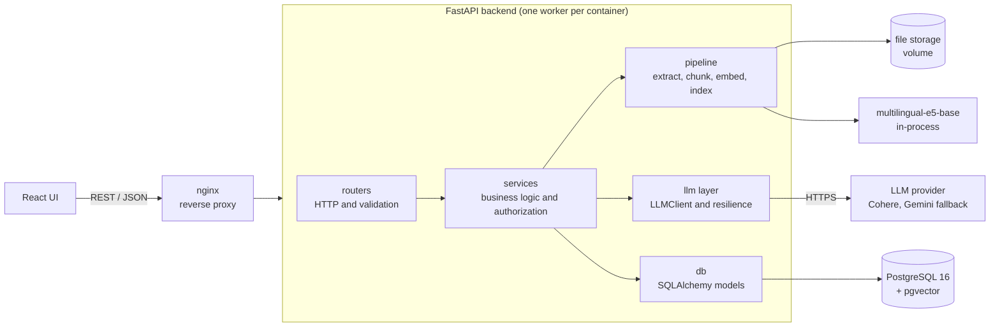
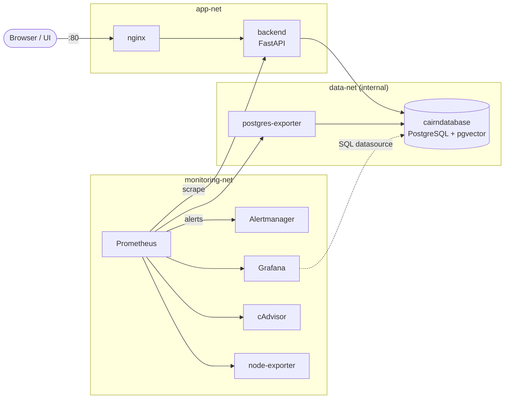
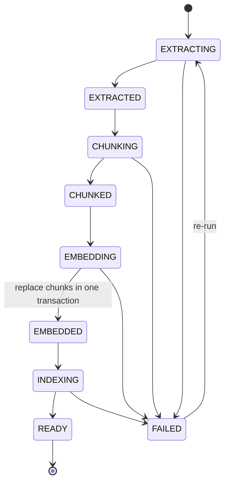
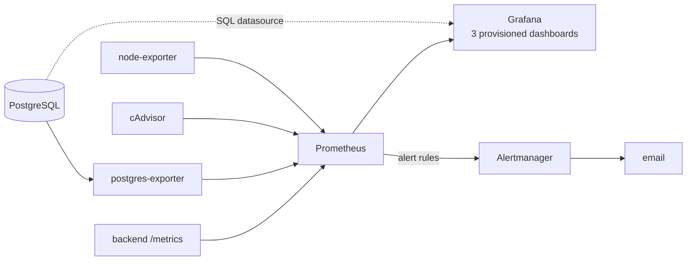
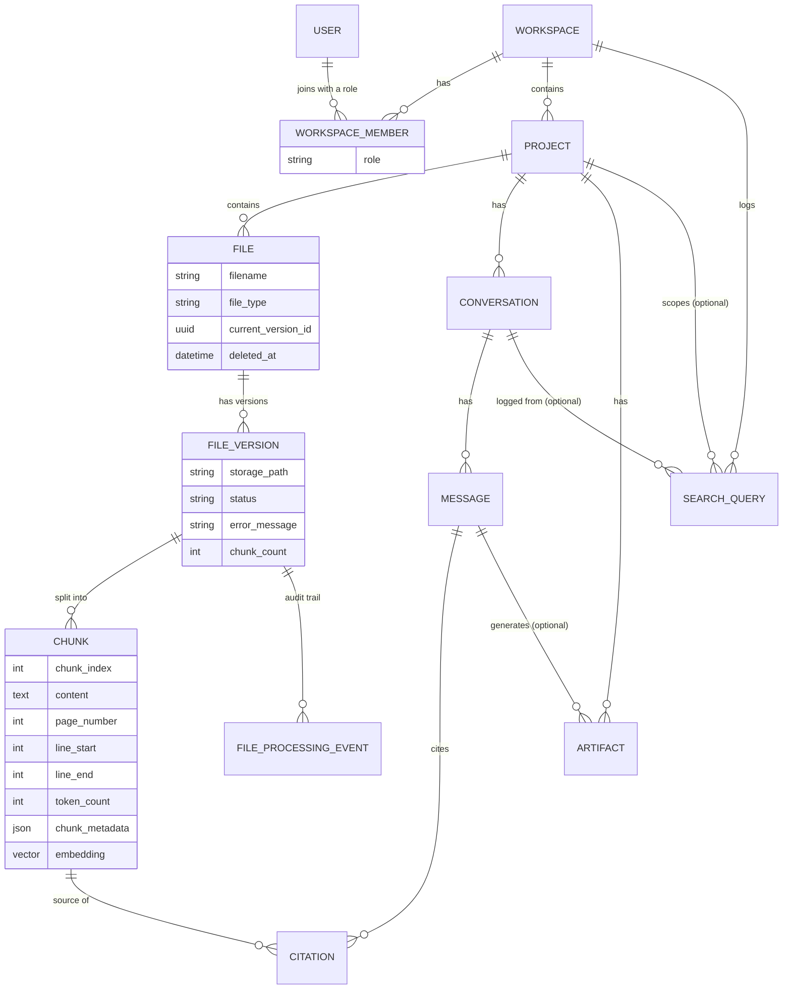

<div align="center">

</div>


##  Tech Stack


<p align="center">
  <picture>
    <source media="(prefers-color-scheme: dark)" srcset="docs\assets\banner-dark.png">
    <source media="(prefers-color-scheme: light)" srcset="docs\assets\banner-dark.png">
    
  </picture>
</p>

---

**A document-grounded question-answering platform that allows users to upload documents, retrieve relevant information, and generate answers supported by source citations.**

Cairn is a platform where users can organize documents into workspaces and projects, ask questions over any slice of them, get answers whose every claim is traceable to a source page or line range, and generate study and analysis artifacts (quizzes, flashcards, charts, diagrams…) from the same sources. The whole stack (API, database, gateway, metrics, dashboards, alerting) is orchestrated using a single Docker Compose file.

---

https://github.com/user-attachments/assets/2c208f25-5ddf-4a3d-bfe2-9f99a18d5f1a

---

## Table of contents

1. [Overview](#1-overview)
2. [Architecture](#2-architecture)
3. [Engineering deep dives](#3-engineering-deep-dives)
4. [Data model](#4-data-model)
5. [API overview](#5-api-overview)
6. [Design decisions and trade-offs](#6-design-decisions-and-trade-offs)
7. [Tech stack](#7-tech-stack)
8. [Project structure](#8-project-structure)
9. [Getting started](#9-getting-started)
10. [Configuration](#10-configuration)

---

## 1. Overview

### The problem

A basic "upload a PDF and chat with it" RAG demo breaks down quickly in real use:

| Real-world problem | How this project addresses it |
|---|---|
| Answers can't be verified, so users can't trust them | Every answer carries citations mapped to a file, page or line range, chunk id and the exact source text. Citations are derived by code, never produced by the model (see [3.5](#35-answer-generation-and-explainable-citations)). |
| Knowledge bases are collections of many documents, not one file | A **Workspace → Project → Files** hierarchy. Questions can target a whole project, one file, or a chosen subset of files. |
| Content is multilingual (Arabic and English) | Multilingual embeddings, Arabic-aware sentence splitting, encoding fallbacks for legacy Arabic text files, and Arabic questions answered from English sources. |
| Source code is not prose | Python files are parsed with `ast` and chunked per class, function and method, with structural metadata (see [3.2](#32-chunking)). |
| LLM providers rate-limit, time out and change | A provider-agnostic LLM layer with a unified error hierarchy, a resilience decorator (retries, backoff, concurrency cap, pacing) and a configurable fallback provider. |
| Files get re-uploaded and edited | File versioning: only the current version of a file is ever searchable. |
| Several people need to work on the same knowledge base | JWT authentication and workspace-level RBAC (Owner / Editor / Viewer), invite links, join requests with approval, and an activity log. |
| Nobody can tell what a deployed AI system is doing | Prometheus metrics for HTTP, the database pool, the RAG pipeline and the LLM (latency, tokens, estimated cost, errors, queueing), three Grafana dashboards and email alerting. |

### Feature summary

| Area | What is implemented |
|---|---|
| Knowledge organization | Workspaces, projects, files, file versions, soft delete |
| Ingestion | Content validation, text extraction, token-aware chunking, embedding, indexing, with per-stage status and an audit trail |
| Supported upload formats | **PDF, TXT and Python source (`.py`)** |
| Retrieval | Semantic search (cosine similarity, pgvector HNSW) scoped to a workspace, a project, a file or a file subset |
| Chat | Scoped Q&A with grounded answers and citations, plus in-chat artifact generation |
| Artifacts | Summary, Quiz, MCQ, Flashcards, Keywords, Chart, Diagram, each validated against a strict content contract |
| Collaboration | Workspace visibility, share links (regenerate / revoke), join requests, roles, activity log |
| Security | JWT access + rotating refresh tokens with revocation, RBAC, magic-byte file validation, tenant isolation, network isolation of the database |
| Observability | Prometheus + Grafana + Alertmanager (email), PostgreSQL / container / host metrics, 32 alert rules |
| Deployment | Docker Compose with network segmentation, health checks, automatic migrations, profiles and a dev override |

---

## 2. Architecture



### Layering rules

* **Routers** only parse and validate HTTP input and delegate. They contain no business logic.
* **Services** hold the business rules and authorization checks (ownership is verified through joins, so a user can never reach another tenant's rows).
* **`pipeline/`** is pure processing (extraction, chunking, embedding, indexing), orchestrated by one thin module that contains no processing logic of its own.
* **`llm/`** is infrastructure ("talk to a model"). RAG prompt design lives in `services/answer_service.py` because it is application logic, so `llm/` knows nothing about RAG and the answer service knows nothing about any vendor.
* **`monitoring/`** holds the Prometheus metrics and the ASGI middleware, so instrumentation never leaks into business code beyond one-line `with` blocks.
* **Dependencies point inward:** application code depends on the `LLMClient` interface and plain dataclasses, never on a vendor SDK.


### Runtime topology (Docker Compose)



* **`data-net` is an internal network** with no route to the internet. Only the services that need the database join it, so the database cannot be reached from outside or call out.
* **nginx is the only entry point** to the API. The backend publishes no port; `/metrics` is scraped by Prometheus over the internal network, and nginx answers 404 for it.
* **Compose profiles:** `docker compose up` starts the core stack (database, backend, nginx). `--profile monitoring` adds Prometheus, Alertmanager, Grafana and the three exporters, so a laptop does not pay for observability during everyday work.
* **Migrations run at container start** (`entrypoint.sh` runs `alembic upgrade head`, then `exec`s the server). The backend starts only after the database reports healthy.

---

## 3. Engineering deep dives

### 3.1 Ingestion pipeline



`pipeline/ingestion.py` is an orchestrator only. The stages live in `extraction.py`, `chunking.py`, `embedding.py` and `indexing.py`. Its reliability properties are deliberate:

* **Visible progress.** Every stage transition is committed immediately and recorded as a `FileProcessingEvent`, so the UI shows real state rather than a spinner.
* **Embed first, replace after.** Chunks are embedded in memory before the old ones are touched. Deleting the old chunks, inserting the new ones and moving the status to `EMBEDDED` happen in one transaction, so a failed re-run never leaves a file with half-replaced or missing chunks.
* **Re-runnable by design.** Running a version again replaces its chunks. There is no cleanup step to forget.
* **The pipeline never raises.** Failures are recorded on the file version. A failed stage first rolls back the broken transaction, because otherwise the session is unusable and the `FAILED` status could not be saved.
* **Two classes of error messages.** Errors the stages raise on purpose (`ExtractionError`, `EmbeddingError`) carry messages that are safe to show in the UI. Anything unexpected is logged with a stack trace but surfaced only as a generic message, so internals never leak.
* **Background execution with its own session.** The background task opens its own database session and receives only an id, because the request's session is closed as soon as the response is sent.
* **Every stage is timed** (`ingestion_stage_duration_seconds`), so the dashboard shows where ingestion time goes.

**Extraction (`extraction.py`)** validates before it parses:

* Files are checked by **magic bytes**, not by extension (the PDF header, "looks binary" detection for text formats).
* Encrypted PDFs, scanned or image-only PDFs, and empty documents are rejected with clear messages (there is no OCR stage).
* Text decoding handles UTF-8 with BOM, UTF-16 and a **`cp1256` fallback** for legacy Arabic files.
* For TXT and Python the normalization is intentionally light and **never changes the number of lines**, so line numbers used in citations still match the original file.

### 3.2 Chunking

`pipeline/chunking.py` splits text so that retrieval units are the right size for the embedding model and so that every chunk can be traced back to an exact location.

* **Measured in tokens, not characters.** The length function is the embedding model's own tokenizer, so a chunk is exactly what the model will see. If `CHUNK_SIZE_TOKENS` exceeds the model's maximum sequence length, the pipeline logs a warning at start-up (silent truncation of chunk tails would otherwise degrade retrieval without any error).
* **Page-exact citations.** Each PDF page is chunked on its own, so a chunk never spans two pages and `page_number` is always correct.
* **Line ranges** (`line_start`, `line_end`) are tracked for TXT and Python. Chunk positions are located by searching forward in the original text rather than trusting the splitter's offsets, because those assume character-based overlap and drift when sizes are measured in tokens.
* **Arabic-aware separators.** The recursive splitter's separator list includes Arabic punctuation (`؟` and `؛`) alongside Latin sentence boundaries.

**Structure-aware chunking for Python (`python_parser.py` + `chunking.py`).** Source code is parsed with the standard library's `ast` (no LLM, no model, no I/O) into ordered `CodeUnit`s:

* One chunk per **class outline, function and method**. A class chunk contains its docstring, class-level statements and a list of method signatures with line ranges; the methods are separate chunks, so no code is duplicated.
* Small module-level pieces (docstring, imports, constants, `if __name__ == "__main__"`) are packed together instead of becoming tiny chunks.
* Oversized units are split on line boundaries, preferring blank lines, and **each part keeps a header** (qualified name, kind, line range, "part i/n", imports used) so it is understandable on its own.
* Every chunk stores structural metadata (symbol, signature, parent class, decorators, base classes, docstring, imports used, intra-file calls).
* **Guarantees:** line numbers are exact, unit text is the verbatim source (including decorators and the comment block above a definition), and code outside definitions is never dropped.
* **Graceful degradation:** a syntax error, an oversized file or a file without code structure falls back to plain-text chunking, tagged `parse_status: "fallback"` in the metadata, instead of failing the upload.

### 3.3 Embeddings and vector search

* **Model:** `multilingual-e5-base` (768 dimensions), chosen because the corpus mixes Arabic and English and development runs on CPU.
* **Model contract enforced at load time.** The service verifies that the model's output dimension equals the configured `EMBEDDING_DIM` and fails fast on a mismatch. After every encode it checks the output shape and rejects NaN or infinite values.
* **E5 conventions are respected.** Documents and queries use configurable prefixes (`passage: ` and `query: `), and vectors are L2-normalized, which matches the **cosine HNSW index** in PostgreSQL.
* **Concurrency safety.** Encoding and tokenization are serialized with a lock because the Hugging Face tokenizer is not thread-safe, and background tasks otherwise share one model instance.
* **GPU-ready.** On an out-of-memory error the encoder halves the batch size and retries rather than failing. Development uses CPU, and the Docker image installs CPU-only PyTorch by default; a GPU build is one build argument away.
* **Preloaded at start-up.** The API loads the model during startup so the first upload or search does not pay the load time, and a load failure does not stop the API from booting.
* **One database for relational data and vectors** (see the [decision table](#6-design-decisions-and-trade-offs)).

### 3.4 Retrieval, scoping and versioning

* All searches go through shared query construction that **joins chunk → file version → file and only matches `File.current_version_id`**, so superseded versions and soft-deleted files can never appear in results.
* **Scope** is enforced in SQL: workspace-wide, a project, a single file, or an arbitrary subset of files.
* Semantic search returns a cosine similarity score (`1 - distance`) and an excerpt; each search is stored in a history table.
* Retrieval for generation returns the top-k chunks **re-ordered into document order**, and a `stride_sample` helper gives even coverage of a large scope instead of just its beginning.
* Retrieved chunks are mapped to immutable value objects (`ScopedChunk`), so consumers such as artifact strategies are plain Python and testable without a database.
* Every retrieval path (chat, search, artifact scope) goes through one helper that records latency, number of chunks and **empty results**, so retrieval problems show up on a dashboard instead of as vague "bad answers".

### 3.5 Answer generation and explainable citations

`services/answer_service.py` turns retrieved passages and a question into a grounded answer.

* **Citations are computed, never generated.** Passages are numbered `[1]…[k]` in the prompt. The model cites with markers, and the service maps each marker back to a chunk id. The model is never asked to produce ids, so it cannot invent one.
* **Marker hygiene.** Markers that point at a non-existent passage are removed from the text. Markers inside code (for example `arr[1]`) are left untouched, so code is never corrupted.
* **Prompt-injection hygiene.** Passages are declared untrusted data, not instructions. Document text is also neutralized so it cannot close or reopen the prompt's own `<passages>` and `<question>` delimiters. This reduces the risk; it does not make it zero.
* **Grounding rules.** The system prompt requires every claim to be cited, requires an explicit "the passages do not contain this" answer instead of filling gaps with outside knowledge, and requires replying in the language of the question.
* Each citation carries the filename, page number or line range, chunk id and exact source text, which is what allows a UI to open the page and highlight the passage.

### 3.6 LLM abstraction layer

The `llm/` package is a small, provider-agnostic layer.

| Module | Responsibility |
|---|---|
| `base.py` | The `LLMClient` interface and immutable dataclasses (`LLMRequest`, `LLMResponse`, `TokenUsage`…). Two operations only: free text and schema-validated structured output. |
| `config.py` | An immutable `LLMConfig` built from application settings. Providers never see the app-wide settings object, so they are testable in isolation. A naming convention (`<PROVIDER>_API_KEY`, `<PROVIDER>_<OTHER>`) means a new provider needs no settings code. |
| `errors.py` | A unified error hierarchy. Each error has an internal message for logs, a **safe `public_message`** for API responses, a `retryable` flag and an optional provider-supplied `retry_after`. No SDK exception ever leaks past a provider. |
| `factory.py` | A registry-based factory. Providers are imported lazily, so a vendor SDK is only loaded when that provider is selected. Adding a provider means one class plus one `register_provider` call, and no caller changes. |
| `resilience.py` | A decorator, applied identically to every provider (see below). |
| `providers/` | Cohere and Gemini clients and a deterministic fake client for tests. |
| `metrics.py` | Prometheus instrumentation for the layer. |

The primary provider is selected with `LLM_PROVIDER` / `LLM_MODEL` (Cohere in the default configuration), and a fallback provider can be configured with `LLM_FALLBACK_PROVIDER` / `LLM_FALLBACK_MODEL` (Gemini in the default configuration).

`ResilientLLMClient` adds, once and uniformly:

* **Retries with exponential backoff and jitter**, only for errors marked retryable.
* **Honoring the provider's `retry_after` hint**, and refusing to wait longer than `max_wait`. A daily quota that resets in hours surfaces an error instead of hanging a request.
* A **concurrency cap** (a semaphore, released while sleeping between retries so other callers keep going) and optional **requests-per-minute pacing**, which avoids burning retries on predictable 429s on free and trial tiers.
* **Structured logging of every call** (provider, model, latency, token usage, attempt). Prompts and answers are never logged, because they contain user documents.

Structured output is validated with the schema's own pydantic validators. Failure raises `LLMInvalidResponseError`, whose `detail` can be fed back for a corrective retry.

### 3.7 Artifact engine

Artifacts are structured outputs generated from the chunks in scope: **Summary, Quiz, MCQ, Flashcards, Keywords, Chart and Diagram**.

* Each type has a strategy whose output is **validated against the content contract** the frontend renders (for example, quiz questions with `id`, `question` and `answer`; chart data with a chart type, x key and series; diagram nodes with coordinates).
* The engine decides whether a type **fits the sources**. If it does not, it returns a `Mismatch` with a reason and suggested alternatives rather than inventing content. The Artifacts page maps this to an HTTP 422, and the chat renders a card with a "generate anyway" action.
* A topic narrows generation to the chunks semantically closest to it.
* Generation is shared by the Artifacts page and the chat through a single `build_outcome` function, so both paths behave and are measured identically (outcome per type: ok, mismatch, insufficient data, no content, error).
* Chat answers can also be **saved as artifacts**, preserving structured content as-is.

### 3.8 Authentication, RBAC, collaboration and security

* **JWT** access tokens with **rotating refresh tokens** and server-side revocation on logout.
* **RBAC at workspace level:**
  * *Owner*: full control, including members, sharing and deletion
  * *Editor*: create, edit and delete projects, files, conversations and artifacts
  * *Viewer*: read-only, but can still ask questions
* Workspaces are **private or shared**. Sharing uses an invite link that can be regenerated or revoked, and join requests require approval. An **activity log** records workspace events.
* Authorization is enforced in the service layer using ownership joins, and **cross-user isolation is covered by end-to-end tests** .
* **Hardening in the deployment:** the database lives on an internal-only network; the backend publishes no port and runs as a non-root user; `.env` files are excluded from the image and passed at run time; the SMTP password is a file-based Docker secret; `/metrics` is never reachable through nginx; uploaded files are validated by content, not by name.

### 3.9 Observability



**Application metrics (`prometheus_client`, package `monitoring/`)**

* **HTTP.** A hand-written pure-ASGI middleware (not `BaseHTTPMiddleware`, which interferes with streaming) records request count, latency and in-flight requests. Paths are labelled with the **route template** (`/projects/{project_id}`) and unmatched routes collapse into one label, so cardinality stays bounded even under scanner traffic.
* **LLM.** The instrumentation sits inside the resilience decorator, the only place that can see retries, queueing and provider latency separately:
  * calls by final outcome (after retries) and individual attempts
  * retries by reason
  * provider latency vs end-to-end latency vs **queue wait**
  * tokens by type
  * **estimated cost** from a configurable price table (the real bill on a free tier is zero)
  * finish reasons (so truncated answers are visible)
  * "accounting gap" counters for responses without usage data or models without a price
* **RAG pipeline.** Retrieval latency, chunks returned and empty-retrieval count (per source: chat, search, scope), embedding latency (query vs passage), ingestion stage durations, files processed by result, and artifacts generated by type and outcome.
* **Database pool.** A custom collector reads SQLAlchemy pool state at scrape time.
* A scoped context manager tags LLM calls with the **operation** (`chat_answer`, `artifact_quiz`, …) from a fixed vocabulary, so tokens and cost can be attributed to a feature.

**Infrastructure metrics.** `postgres-exporter` (including `pg_stat_statements`), cAdvisor for containers and node-exporter for the host.

**Dashboards** (provisioned as code, so they are versioned with the repo):

| Dashboard | Focus |
|---|---|
|  cairn– FastAPI | Traffic, error rates, latency percentiles, busiest / slowest / failing paths, DB pool, retrieval and embedding latency, ingestion stages, artifacts |
| cairn – LLM | Calls, failure rate, timeouts, retries, provider and end-to-end latency, queue depth, tokens, estimated cost, truncation |
| carin – Infrastructure | Stack health, PostgreSQL (connections, cache hit ratio, deadlocks, live queries, slowest statements, index sizes), containers, host |

**Alerting.** 32 rules (lint with `promtool check rules`) cover target and database down, API 5xx rate and latency, LLM auth failures, failure rate, timeouts, rate limiting, queue backlog and latency approaching the proxy timeout, ingestion failures, empty retrievals, truncated answers, DB pool saturation, PostgreSQL connections and cache hit ratio, container OOM kills and restarts, host disk, memory and CPU, and a `Watchdog` plus notification-failure meta alerts. Alertmanager routes by severity to email with inhibition rules, so one outage does not send a dozen messages, and the always-firing `Watchdog` is routed to a null receiver. Thresholds are sensible starting points, not values tuned on production traffic.

### 3.10 Containerization

* **Backend image:** built on a `uv` Python base. CPU-only PyTorch is installed first from the PyTorch CPU index (the default wheel would pull about 3 GB of CUDA packages), the rest of the dependencies come next with a build cache, and the application runs as a non-root user. A guard fails the build if CUDA packages sneak into a CPU build, and a build argument selects another PyTorch index for GPU servers.
* **Entrypoint** applies migrations, then hands over to the server with `exec`, so the server is PID 1 and receives signals.
* **Health checks** on the database and the backend; the backend waits for a healthy database, and nginx waits for a healthy backend. The backend's check allows a long start period because the first start downloads the embedding model into a named volume.
* **nginx** re-resolves the backend's address through Docker's DNS, so a rebuilt backend is picked up without restarting the gateway.
* Resource-friendly defaults: log rotation, **pinned image versions**, and named volumes for the database, uploads, the model cache and the monitoring data.
* PostgreSQL starts with `pg_stat_statements`, slow-query logging and an explicit `max_connections`, and an init script enables the `vector`, `citext` and `pg_stat_statements` extensions on a fresh volume.

---

## 4. Data model

Simplified; see `Backend/app/models/` for the source of truth.



Key points:

* `File.current_version_id` is what makes versioning and "only the current version is searchable" a simple join condition.
* Vectors live next to their text and provenance (`page_number`, `line_start/end`, structural metadata), so a search hit carries everything a citation needs without a second lookup.
* Users' emails use the `citext` type (case-insensitive), and embeddings use `vector(768)` with a cosine HNSW index. Both are created through migrations and validated at runtime.

---

## 5. API overview

The backend exposes 30+ REST endpoints under the `/api/v1` prefix, grouped into routers. Interactive documentation (OpenAPI) is served by FastAPI at `/docs`.

| Router | Responsibility |
|---|---|
| `auth` | Register, login, refresh (rotating), logout / revoke |
| `workspace` | Workspace CRUD and visibility |
| `workspace_members` | Membership and role management |
| `workspace_invite` | Share links: create, regenerate, revoke, join |
| `workspace_join_requests` | Request, approve or reject |
| `project` | Projects, nested under a workspace, ownership enforced via joins |
| `file` | Upload, versions, processing status, delete |
| `conversation` | Conversations, messages, per-conversation file scope, in-chat artifact generation |
| `artifact` | Generate, save from a message, list, filter, download |
| `search` | Semantic search and search history |

Errors use a consistent envelope (`{"error": {"code", "message", "details"}}`) with stable machine-readable codes, and LLM failures are translated centrally by an exception handler into HTTP responses that use the safe public messages. Health endpoints (`/health/live`, `/health/ready`) back the container health checks.

---

## 6. Design decisions and trade-offs

| Decision | Why | Trade-off accepted |
|---|---|---|
| **pgvector inside PostgreSQL** instead of a separate vector database | One store for relational data and vectors. Scope filters are plain joins, and chunk replacement, status changes and vectors commit atomically. One less service to run, secure and back up. | Filtered ANN search can return fewer than *k* results (post-filtering on an HNSW index), and there is a scale ceiling versus a dedicated engine. Empty-retrieval metrics exist to watch for it. |
| **Citations derived by code** | The model can never fabricate a chunk id, and invalid markers are stripped deterministically. | The model must follow the `[n]` convention. Non-compliance degrades to an answer with fewer citations, not to a wrong one. |
| **Resilience as a decorator** instead of per-provider retry code | Behavior is identical and tested once for every provider, and providers stay thin. | One extra layer of indirection. |
| **Synchronous LLM interface** | The app's endpoints, services and ingestion tasks are sync and run in worker threads. An async variant can be added without touching sync callers. | No token streaming yet. |
| **Commit after every ingestion stage** | Real progress is visible in the UI, and a crash leaves an accurate status. | More commits than a single transaction would need. Chunk replacement itself remains atomic. |
| **Embed first, replace after** | A failed re-embed never destroys good data. | Peak memory holds all vectors of a file at once. |
| **Token-based chunk sizing with the model's own tokenizer** | Chunks match what the model actually reads, with no silent truncation. | Tokenization cost during chunking, and the tokenizer must be loaded (and its access serialized). |
| **AST-based chunking for Python** | Retrieval units correspond to meaningful code units with exact line ranges. | A separate parser to maintain, with a plain-text fallback for unparseable files. |
| **Service-layer authorization via ownership joins** | A tenant can't reach another tenant's rows even if a router forgets a check. | Slightly more verbose queries. |
| **One Uvicorn worker per container** | `prometheus_client` metrics are per-process. Scale by adding containers, not workers. | Horizontal scaling needs service discovery in Prometheus. |
| **Internal Docker network for the database** | The database is unreachable from the host and from the internet-facing network. | Tools that need DB access (Grafana's SQL datasource, exporters, local clients) must join a network explicitly; local access goes through a dev-only override. |
| **nginx as the single entry point** | One place for upload limits, timeouts and blocking `/metrics`. The frontend talks to the same gateway in development and in a deployed setup. | An extra hop in development. |
| **Migrations at container start** | A fresh clone comes up with the right schema and no manual step. | With several backend replicas the migration step would need to become a separate one-shot job. |
| **Route templates as metric labels** | Bounded metric cardinality. | Per-resource latency isn't available, by design. |

---

## 7. Tech stack

| Layer | Technology |
|---|---|
| API | Python 3.10, FastAPI, Pydantic v2, SQLAlchemy, Alembic |
| Database | PostgreSQL 16 with pgvector (HNSW, cosine) and `citext` |
| Embeddings | sentence-transformers, `multilingual-e5-base` |
| Document processing | pypdf, `langchain-text-splitters`, stdlib `ast` |
| LLM | Provider-agnostic layer; Cohere and Gemini clients (via their SDKs), fallback provider, and a fake client for tests |
| Auth | JWT with rotating refresh tokens |
| Observability | `prometheus_client`, Prometheus, Grafana, Alertmanager, postgres-exporter, cAdvisor, node-exporter |
| Infrastructure | Docker, Docker Compose, nginx, `uv` |
| Frontend | React and TypeScript on Vite and TanStack Start (`@xyflow/react` for diagrams, `recharts` for charts), scaffolded with [Lovable](https://lovable.dev) against the API and artifact contracts defined in this repository |

---

## 8. Project structure

```
.
├── Backend/
│   ├── app/
│   │   ├── main.py
│   │   ├── core/            # security, storage
│   │   ├── db/              # engine, session, base
│   │   ├── dependencies/    # FastAPI dependencies (auth, RBAC)
│   │   ├── enums/
│   │   ├── helpers/         # config, logging, exception handlers
│   │   ├── llm/             # base, config, errors, factory, resilience, metrics, pricing, providers/
│   │   ├── models/          # SQLAlchemy models
│   │   ├── monitoring/      # Prometheus metrics and ASGI middleware
│   │   ├── pipeline/        # extraction, chunking, python_parser, embedding, indexing, ingestion
│   │   ├── routers/
│   │   ├── schemas/         # Pydantic request/response models
│   │   ├── services/        # business logic, artifacts/ (engine + per-type strategies)
│   │   └── storage/         # uploads and embedding cache (git-ignored, volumes in Docker)
│   ├── alembic/             # migrations
│   ├── tests/
│   ├── scripts/
│   ├── Dockerfile
│   ├── entrypoint.sh
│   ├── alembic.ini
│   └── requirements.txt
|
├── docs/
│   ├── assets/           #  images (banner, diagrams, screenshots)
│   └── postman/          # Postman collection and environment files
|
├── Frontend/                 # React UI (Vite dev server proxies /api to nginx) 
|              
├── infrastructure/
│   ├── docker-compose.yaml
│   ├── docker-compose.override.yaml   # dev-only published ports (database on 127.0.0.1:5433)
│   ├── .env.example
│   ├── alertmanager/alertmanager.yml
│   ├── docker/
│   │   ├── nginx/nginx.conf
│   │   ├── postgres/init/   # extensions (vector, citext, pg_stat_statements)
│   │   └── prometheus/      # prometheus.yml, rules/alerts.yml
│   ├── grafana/
│   │   ├── provisioning/    # datasources (Prometheus, PostgreSQL), dashboards
│   │   └── dashboards/      # rag-fastapi, rag-llm, rag-infrastructure (JSON)
│   └── secrets/             # smtp_password.txt (git-ignored)
├── demo-files/              # synthetic sample documents for trying every feature
└── README.md
```

---

## 9. Getting started

### Prerequisites

* Docker and Docker Compose v2
* An API key for your LLM provider (a Cohere trial key and a Gemini free-tier key are enough for development)
* Node.js (for the frontend dev server)

### 1. Configure

```bash
# compose-level variables (database credentials, Grafana admin)
cp infrastructure/.env.example infrastructure/.env

# application settings (LLM keys, JWT secret, embedding and chunking settings)
cp Backend/app/.env.example Backend/app/.env
```

Edit both files. Use URL-safe characters in the database password, and generate the JWT secret with
`python -c "import secrets; print(secrets.token_urlsafe(64))"`. E5 prefixes must stay quoted in `.env` (`EMBEDDING_DOC_PREFIX="passage: "`) so the trailing space is preserved.

### 2. Run the core stack

```bash
cd infrastructure
docker compose up -d --build
docker compose logs -f backend
```

Compose project name: `cairn_app`. The first start downloads the embedding model (about 1 GB) into a named volume, so the backend takes a few minutes to become healthy and later starts are fast. Migrations are applied automatically.

| What | Where |
|---|---|
| API (through nginx) | http://localhost/api/v1 |
| Interactive API docs | http://localhost/docs |

### 3. Run the frontend

```bash
cd Frontend
npm install
npm run dev
```

`Frontend/.env` sets `VITE_API_BASE_URL=/api/v1` (a relative URL), and the Vite dev server proxies `/api` to nginx on `127.0.0.1:80`. The browser therefore only ever talks to one origin and no CORS configuration is involved.

### 4. Add monitoring

```bash
cd infrastructure
docker compose --profile monitoring up -d
```

| Service | URL |
|---|---|
| Grafana | http://localhost:3000 |
| Prometheus | http://localhost:9090 |
| Alertmanager | http://localhost:9093 |

Dashboards are provisioned automatically under the **RAG Platform** folder. Monitoring ports are bound to `127.0.0.1` only.

### 5. Email alerts (optional)

1. Edit the SMTP host, sender, login and recipient in `infrastructure/alertmanager/alertmanager.yml`.
2. Store the SMTP password (for Gmail, an app password) in `infrastructure/secrets/smtp_password.txt` (git-ignored, mounted as a Docker secret).
3. Send a test alert:

```bash
curl -XPOST http://localhost:9093/api/v2/alerts -H 'Content-Type: application/json' -d '[
  {"labels":{"alertname":"TestAlert","severity":"critical"},
   "annotations":{"summary":"Test email from Alertmanager"}}]'
```

### Production-style run (no dev ports)

```bash
cd infrastructure
docker compose -f docker-compose.yaml up -d
```

Naming the base file explicitly skips the dev override, so the only published port is nginx on 80.

### Backend without Docker

```bash
cd Backend/app
python -m venv .venv && source .venv/bin/activate     # Windows: .venv\Scripts\activate
pip install -r ../requirements.txt
uvicorn main:app --reload
```

Migrations from your machine (PowerShell: `$env:PYTHONPATH="app"`):

```bash
cd Backend
PYTHONPATH=app alembic upgrade head
```

This needs a PostgreSQL 16 instance with the `vector` and `citext` extensions (the `pgvector/pgvector:pg16` image works) and `DATABASE_URL` in `Backend/app/.env` pointing at it (for the Compose database from the dev override, use `127.0.0.1:5433`).

### Troubleshooting

| Symptom | Likely cause and fix |
|---|---|
| Backend stays unhealthy on the first start | The embedding model is still downloading. Follow `docker compose logs -f backend`. |
| Grafana shows the dashboards but no data | Most panels are driven by usage. Use the app (ask a question, upload a file) and set the time range to the last 15 minutes. |
| Container panels in Grafana are empty on Docker Desktop (Windows) | cAdvisor may not expose the container `name` label there. Linux hosts work out of the box. |
| `host not found` or 502 from nginx | The backend is not healthy yet, or was just recreated. nginx re-resolves the name every 10 seconds. |
| Query embeddings look off after editing `.env` | The E5 prefixes lost their trailing space. Quote them, and re-embed existing files after changing them. |

---

## 10. Configuration

All configuration is environment-driven. The most important settings (see `.env.example` files for the full list):

| Variable | Purpose |
|---|---|
| `POSTGRES_USER` / `POSTGRES_PASSWORD` / `POSTGRES_DB` | Database credentials (in `infrastructure/.env`; the backend's `DATABASE_URL` is derived from them by Compose) |
| `GRAFANA_ADMIN_USER` / `GRAFANA_ADMIN_PASSWORD` | Grafana login |
| `JWT_SECRET_KEY` | Signing key for access and refresh tokens |
| `LLM_PROVIDER`, `LLM_MODEL` | Primary provider and model the factory builds |
| `LLM_FALLBACK_PROVIDER`, `LLM_FALLBACK_MODEL` | Fallback provider and model |
| `COHERE_API_KEY`, `GEMINI_API_KEY` | Provider credentials (any provider follows `<PROVIDER>_API_KEY`) |
| `LLM_TIMEOUT_SECONDS`, `LLM_MAX_RETRIES`, `LLM_RETRY_BASE_DELAY`, `LLM_MAX_RETRY_WAIT` | Resilience behavior |
| `LLM_MAX_CONCURRENCY`, `LLM_REQUESTS_PER_MINUTE` | Concurrency cap and client-side pacing (set it for trial and free tiers) |
| `LLM_TEMPERATURE`, `LLM_MAX_OUTPUT_TOKENS` | Generation defaults |
| `EMBEDDING_MODEL_NAME`, `EMBEDDING_DIM` | Embedding model and its expected dimension (validated at load) |
| `EMBEDDING_BATCH_SIZE`, `EMBEDDING_DEVICE`, `EMBEDDING_CACHE_DIR` | Encoding and model-cache behavior |
| `EMBEDDING_DOC_PREFIX`, `EMBEDDING_QUERY_PREFIX` | E5 prefixes (keep the trailing space, quoted) |
| `CHUNK_SIZE_TOKENS`, `CHUNK_OVERLAP_TOKENS` | Chunking (keep the size below the model's max sequence length) |
| `STORAGE_BASE_PATH` | Where uploaded files are stored |
| `CORS_ALLOWED_ORIGINS` | Browser origins allowed to call the API directly |

Switching provider is a configuration change once a provider class is registered: set `LLM_PROVIDER` and `<PROVIDER>_API_KEY`. Estimated LLM cost uses a price table (`llm/pricing.py`); add your model there to get a non-zero estimate.

---

## Author

**Mohamed**

* LinkedIn: [your-profile](www.linkedin.com/in/mohamed-ai-engineer)

## License

This project is licensed under the [MIT License](LICENSE).
